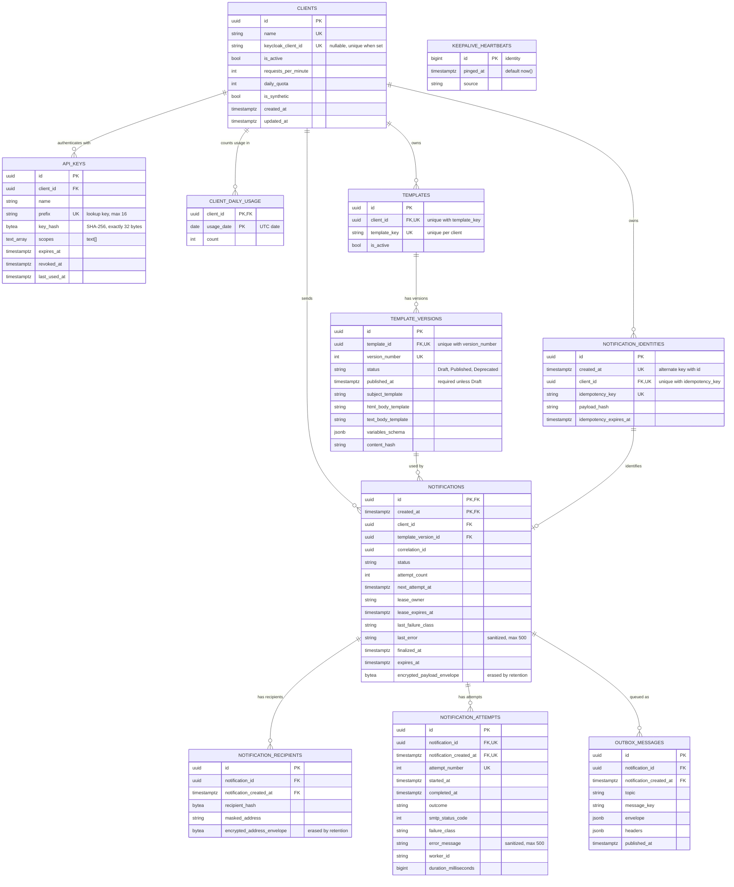

# Data model

This is the v0.1 schema, as created by the `InitialCreate` migration (`src/Data/Migrations/20261125060352_InitialCreate.cs`). Every table lives in the PostgreSQL schema **`kalabit`**, including EF's `__EFMigrationsHistory`. Nothing is created in `public`.

`PK` means primary key, `FK` means foreign key, and `UK` means unique key. Column names are the real snake_case names in the database.

`KEEPALIVE_HEARTBEATS` has no relationships. A scheduled `psql` script writes one row a day so the Supabase free project doesn't pause.

Every table also has a `created_at` column. `CLIENTS` and `TEMPLATES` also have `created_by`, `updated_at` and `updated_by`, and use PostgreSQL's system column `xmin` as their concurrency token, so no extra column is stored for it. The diagram leaves out some of these columns to stay readable.

## Reading the relationship symbols

The symbol at each end describes how many records on that side can take part:

| Symbol | Meaning |
|---|---|
| `|` | One |
| `o` | Zero (optional) |
| `{` | Many (crow's foot) |
| `||` | Exactly one |
| `o|` | Zero or one |
| `|{` | One or many |
| `o{` | Zero or many |

Read a relationship from either end. For example, `CLIENTS ||--o{ NOTIFICATIONS` means each notification has exactly one client, while a client may have zero or many notifications.

All foreign keys use `ON DELETE RESTRICT`. Clients and templates are deactivated with `is_active = false`, not deleted.

## Tables at a glance

| Table | Purpose | Key rules |
|---|---|---|
| `clients` | A company or app that sends email through Kalabit | `name` is unique. `keycloak_client_id` is kept for future OAuth (ADR-0003) and is unique only when it's set |
| `api_keys` | Credentials a client sends as `Authorization: Bearer kb_…` | Only `prefix` and a SHA-256 `key_hash` are stored, never the key. `CHECK (octet_length(key_hash) = 32)` |
| `client_daily_usage` | The daily quota counter, one row per client per UTC day | Natural key (`client_id`, `usage_date`). It is updated with an atomic `INSERT … ON CONFLICT DO UPDATE … RETURNING`. `count >= 0` |
| `templates` | A named template that belongs to one client | (`client_id`, `template_key`) is unique, so clients can't see or use each other's templates |
| `template_versions` | The immutable content of a template | (`template_id`, `version_number`) is unique. A version that isn't a draft must have `published_at`. `version_number > 0` |
| `notification_identities` | The idempotency record for an accepted request | (`client_id`, `idempotency_key`) is unique. All idempotency fields are required, because the `Idempotency-Key` header is required |
| `notifications` | An accepted email **and** its queue entry (ADR-0002) | Composite key (`id`, `created_at`). `attempt_count >= 0`. `lease_owner` and `lease_expires_at` are both null or both set |
| `notification_recipients` | Who the email goes to | Address encrypted, with a hash for lookups and a masked form for display |
| `notification_attempts` | One row per delivery try: the timeline | (`notification_id`, `notification_created_at`, `attempt_number`) is unique |
| `outbox_messages` | Reserved for the Kafka phase. Nothing writes to it in v0.1 (ADR-0002) | Partial index on unpublished messages |
| `keepalive_heartbeats` | Pings that keep the free Supabase project awake | `id` is `GENERATED ALWAYS AS IDENTITY` |

## Queue indexes

The worker uses `notifications` as its queue. Two **partial indexes** contain only the few rows the worker is interested in, so they stay small however many finished notifications pile up:

| Index | Column | Contains only rows where | Used by |
|---|---|---|---|
| `ix_notifications_due` | `next_attempt_at` | `status IN ('Queued', 'Retrying')` | The claim query (`FOR UPDATE SKIP LOCKED`) |
| `ix_notifications_expired_leases` | `lease_expires_at` | `status = 'Sending'` | The reaper, which retries rows whose worker crashed |

A partial index is only used when the query's `WHERE` clause matches the index filter. Enum columns are stored as text (for example `'Queued'`), so the filters compare strings. Renaming an enum member therefore needs a migration that updates these filters too.

## Design notes

- **Composite key on `notifications`.** The key (`id`, `created_at`) is shared with `notification_identities` and referenced by recipients, attempts and outbox rows. It keeps the table ready for monthly partitioning, which is deferred for now (ADR-0010).
- **Timestamps** are set by `AuditTimestampsInterceptor` from `TimeProvider`, so tests can control time and every row saved together gets the same `created_at`.
- **Personal data.** Recipient addresses and payloads are only stored encrypted. Retention erases them 7 days after `finalized_at` and keeps the metadata (PRD, Data model and retention).
