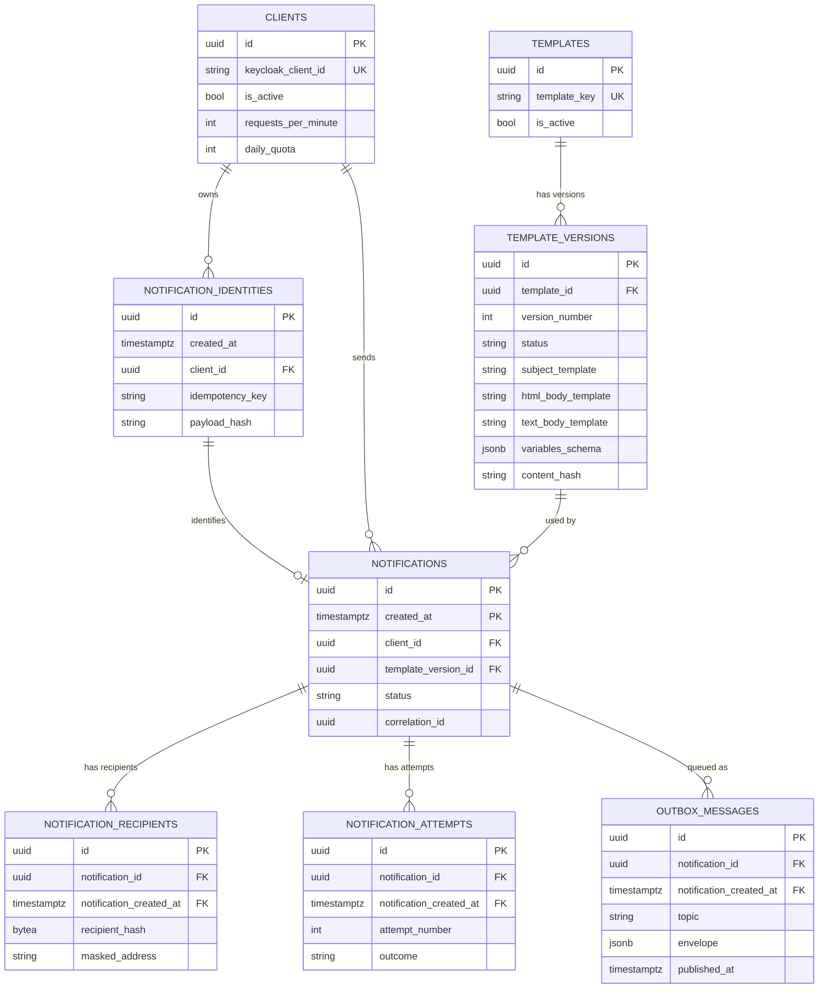

# Data model

This diagram shows the core notification, client, template, and delivery tables.
`PK` means primary key, `FK` means foreign key, and `UK` means unique key.

The symbol at each end describes how many records on that side can participate:

| Symbol | Meaning |
|---|---|
| `|` | One |
| `o` | Zero (optional) |
| `{` | Many (crow's foot) |
| `||` | Exactly one |
| `o|` | Zero or one |
| `|{` | One or many |
| `o{` | Zero or many |

Read a relationship from either end. For example, `CLIENTS ||--o{ NOTIFICATIONS` means each notification has exactly one client, while a client may have zero or many notifications.
